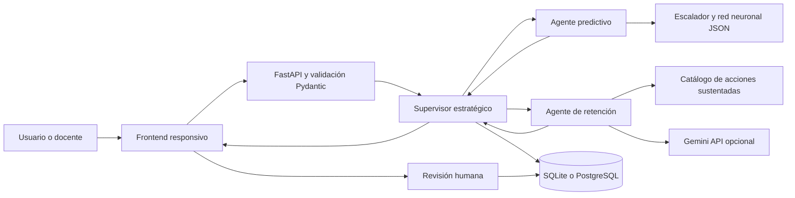
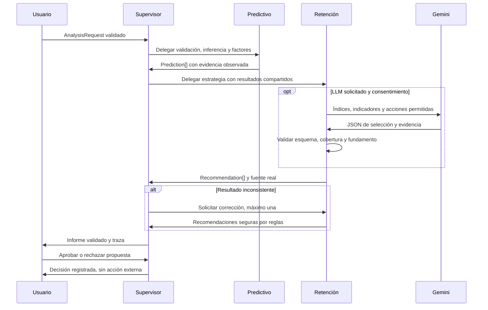

# Arquitectura y colaboración multiagente

La solución sirve HTML, CSS y JavaScript desde FastAPI en el mismo origen. Evita una compilación Node en producción y dependencias de entrenamiento dentro del contenedor. Python ejecuta exactamente las multiplicaciones Dense exportadas. SQLAlchemy permite SQLite local y PostgreSQL externo sin cambiar la API. Un proceso y dos ejecuciones concurrentes simplifican el control de cuota y recursos.

## Contratos y autonomía

`SharedState` contiene ID, tiempo UTC, estado, predicciones, recomendaciones, mensajes, advertencias y consumo. Cada `Message` se valida con Pydantic y conserva emisor, destinatario, herramienta, estado y payload. El predictivo decide riesgo y advierte entradas fuera del dominio. Retención decide entre acciones compatibles con hechos; el supervisor elige delegación, verifica correspondencia cliente a cliente, prioridad, evidencia y estado pendiente. Puede ordenar corrección. Las tres responsabilidades tienen clases, herramientas y políticas diferentes; no son tres nombres para un mismo prompt.

Autonomía acotada: no se afirma que los tres agentes sean LLM. Predictivo y supervisor son agentes especializados deterministas; retención incorpora razonamiento LLM estructurado cuando se configura. Es una arquitectura de supervisor con estado compartido implementada explícitamente, sin LangGraph. La elección reduce dependencias y permite probar todas las transiciones. No hay RAG ni memoria semántica; la memoria persistente son ejecuciones y decisiones. No hay aprendizaje online.

## Herramientas y controles

- Red 6–32–16–8–1; validación de artefacto y hash SHA-256.
- Factores por reemplazo de cada variable por su media exportada: diferencia de probabilidad, no causalidad ni SHAP.
- Reglas de riesgo originales: bajo <0,40, medio [0,40;0,70), alto ≥0,70. Umbral de evaluación binaria 0,50, distinto de segmentación comercial.
- Hasta 18 mensajes, 30 segundos por flujo, dos intentos al proveedor, una corrección del supervisor y dos ejecuciones simultáneas.
- Gemini tiene timeout de 12 segundos por llamada; salida máxima 2.048 tokens; selección LLM para los 20 clientes de mayor probabilidad; reglas para el resto y 50 intentos diarios por defecto, contados en base de datos mediante actualización atómica. Reiniciar SQLite efímero reinicia la cuota: para cuota durable usar PostgreSQL.
- Máximo 300 clientes, 256 KB por cuerpo HTTP y 30 operaciones POST por minuto para todo el proceso. El despliegue usa un solo worker.
- Una decisión humana por cliente/ejecución, insertada atómicamente y no editable. Aprobar no ejecuta acciones externas.

## Seguridad y privacidad

Las rutas de datos, historial y decisiones requieren `Authorization: Bearer APP_API_KEY`. La comparación usa tiempo constante. La clave del navegador vive solo en memoria. Es acceso de administrador compartido para un MVP, no identidad multiusuario, RBAC ni aislamiento entre organizaciones. No usar datos confidenciales hasta implementar identidad individual, permisos y política de retención.

La demo pública acepta únicamente los ejemplos fijos incluidos y no los persiste. La carga CSV admite exactamente siete columnas, IDs alfanuméricos anónimos y campos numéricos; no admite prompts libres. Gemini recibe índices, probabilidades y números, sin códigos de cliente. Se exige consentimiento explícito antes de transmitirlos. La respuesta del LLM selecciona acciones y claves de evidencia permitidas: no se muestra prosa libre potencialmente inventada. La explicación se construye con los hechos verificados. El prompt completo está en `backend/llm.py`.

Se escapa HTML, se neutralizan prefijos de fórmula al exportar CSV y se aplica CSP del mismo origen. No se habilita CORS abierto. Los errores del proveedor no muestran cuerpos ni claves. No hay envío de correos, CRM ni ejecución de código generada por LLM. Tratar las trazas como información empresarial: exportarlas y conservarlas según política del equipo; la retención automatizada y el borrado administrativo quedan fuera del MVP.

## Actualización de experiencia

`GET /api/session` valida el acceso sin consultar históricos. `POST /api/llm/check` requiere autorización, consume el presupuesto diario y usa un ejemplo sintético; informa rechazo, cuota, modelo no disponible o fallo temporal. Los errores permanentes 400/401/403/404/429 no se reintentan. La demo pública de 300 usa únicamente fixtures, no persiste datos ni invoca Gemini. Retención prioriza una acción compatible con la sensibilidad positiva observada. Los planes son propuestas deterministas; el supervisor comprueba responsable, pasos y evidencia.
