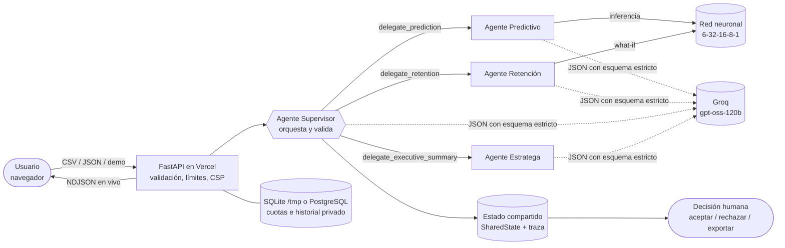

# Arquitectura (v2)



```text
Navegador (HTML/CSS/JS)
   │  JSON / CSV
   ▼
FastAPI ── límites de tamaño, frecuencia, CSP
   │
   ▼
Supervisor ──► Predictivo ──► (LLM: interpret_risk/review_data)
   │               red 6-32-16-8-1 + sustitución a la media
   ├──────────► Retención ──► simulador what-if (red) ──► (LLM: acción del playbook)
   │               plan con responsable, plazo y verificación
   ├── valida: cliente, acción permitida, evidencia, plan, simulación recalculada
   ├── (LLM: approve_plan/request_review)
   ├──────────► Estratega ──► agregados de cartera ──► (LLM: resumen) ──► verificación de cifras
   ▼
Informe + traza ──► revisión humana (aceptar / rechazar / exportar)
```

## Componentes

- **Red neuronal** (`backend/model.py`): inferencia fiel de los pesos exportados, factores por sustitución a la media, ingreso mensual, ingreso en riesgo, salud y método `what_if`.
- **Analítica de cartera** (`backend/analytics.py`): segmentos de riesgo, histograma, sensibilidad media, prioridades por ingreso en riesgo, concentración del riesgo (top 20 %), matriz valor × riesgo con umbral en la mediana de ingreso.
- **Agentes** (`backend/agents.py`):
  - *Supervisor*: delega, valida, solicita una corrección si la salida es inconsistente y vuelve a calcular cada simulación antes de aceptar la recomendación.
  - *Predictivo*: ejecuta la red y, con LLM, emite una interpretación restringida.
  - *Retención*: palancas medibles (`claims`→reclamos=0, `payments`→pagos=0, `reactivate`→15 días). Con reglas elige la palanca de mayor reducción modelada (≥5 pp); con LLM recibe `action_impacts` y elige dentro de las acciones permitidas.
  - *Estratega*: construye hechos verificados y un resumen por reglas; con LLM redacta el resumen y se rechaza si contiene números ausentes en los hechos. Al proveedor no se envían códigos de cliente.
- **Proveedores** (`backend/llm.py`): Groq (chat/completions con `json_schema` estricto) y Gemini (`responseJsonSchema`). Mismo método `generate` para selección y redacción.
- **Almacenamiento** (`backend/storage.py`): SQLAlchemy con SQLite o PostgreSQL; cuotas diarias y decisiones inmutables.

## Garantías y límites

- El riesgo siempre procede de la red; el LLM no lo modifica.
- Un proveedor, cuatro roles: no son cuatro modelos distintos.
- Hasta `LLM_MAX_CUSTOMERS` (10) clientes priorizados reciben revisión LLM; el resto, reglas explícitas. La cartera de prueba tiene 10 clientes para que todos pasen por los 4 agentes.
- Groq con modelo de respaldo (`GROQ_FALLBACK_MODEL`) ante 429, 5xx o tiempo agotado; respuestas incompletas se reintentan y, en el segundo intento, se conservan las selecciones válidas.
- La simulación es sensibilidad del modelo, no efecto causal.
- No hay CRM, correo ni acciones externas; la aceptación es humana. Sin identidad individual de revisores en el modo público.
- La traza se transmite en vivo (NDJSON) y el último paso es siempre la decisión humana.
