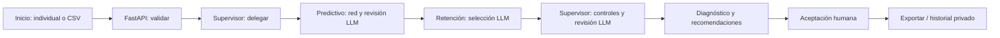

# Respuestas base — cuestionario de Tecnologías Emergentes (A1–K3)

Actualizado el 21/10/2026 según el Word entregado. Completar datos personales, autoría, video y declaraciones antes de entregar. No se han medido efectos comerciales ni realizado entrevistas empresariales.

## A. Identificación
A1–A3: pendientes nombre, código, grupo, integrantes y roles reales. A4: ChurnTrackAI, sistema de analítica predictiva de churn B2B con redes neuronales y tres agentes. A5: https://churntrackai.onrender.com/ . A6: https://github.com/ManuelCarranzaAv/ChurnTrackAI . A7: pendiente video real de 3–5 minutos.

## B. Problema y propuesta
B1: priorizar clientes B2B con señales de abandono y convertir indicadores en recomendaciones revisables. La necesidad es una hipótesis académica; falta evidencia de una empresa.
B2: frente a revisión manual/hojas de cálculo, se reúne inferencia, explicación, recomendaciones y trazabilidad. No se ha demostrado superioridad empresarial.
B3: comparar Gainsight, ChurnZero y Totango con enlaces oficiales y diferencias en REQUISITOS.md. La aportación es académica y reproducible; no una técnica neuronal nueva ni superioridad frente a esos productos.
B4: red neuronal, LLM con JSON estructurado, coordinación multiagente y despliegue web.
B5: objetivo medible: procesar hasta 300 clientes válidos, dar una recomendación a cada uno y exigir revisión humana. Medir cobertura, latencia, rechazos y origen; no prometer reducción real de churn.
B6: objetivo general: integrar predicción y agentes para apoyar retención. Específicos: validar/estimar riesgo; recomendar con evidencia; revisar, aceptar y exportar.

## C. Requerimientos
C1:
| ID | Prioridad | Función / responsable | Criterio de aceptación |
|---|---|---|---|
| RF01 | Alta | Individual / Predictivo | Probabilidad, riesgo y seis factores |
| RF02 | Alta | CSV / API | Hasta 300 filas; rechazar exceso |
| RF03 | Alta | Validación / API | Rechazar nulos, negativos, NaN y duplicados |
| RF04 | Alta | Interpretación / Predictivo + LLM | Evidencia de indicadores válidos |
| RF05 | Alta | Recomendación / Retención + LLM | Acción compatible del catálogo |
| RF06 | Alta | Revisión / Supervisor + LLM | Aprobar consistencia o pedir revisión |
| RF07 | Alta | Decisión / Usuario | Aceptar/rechazar sin acción externa |
| RF08 | Alta | Auditoría / Supervisor | Traza con mensajes y herramientas |
| RF09 | Media | Exportación / Frontend | JSON y planes descargables |
| RF10 | Media | Historial / SQL | Consulta privada autorizada |

C2: Inicio → individual o CSV → Analizar → Diagnóstico → Recomendaciones por cliente/agente → Aceptación → exportación. C3: analista/visitante, revisor humano, administrador y proveedor LLM; no hay cuentas empresariales individuales. C4: excluye CRM, correos, descuentos automáticos, reentrenamiento, gestión multiempresa y seguimiento comercial real.

## D. Tecnología
D1: Python 3.13, FastAPI, Pydantic, SQLAlchemy, httpx y HTML/CSS/JavaScript. Versiones exactas en requirements.txt y requirements-lock.txt. D2: 300 clientes, CSV 256 KB, dos análisis simultáneos, 30 POST/minuto, 60 segundos por coordinación y 32 mensajes. Son límites, no SLA. D3: CSV UTF-8/JSON con código anónimo y seis indicadores: antigüedad, compras mensuales, monto promedio, reclamos, días desde última compra y pagos atrasados. Pesos/datos sintéticos del prototipo; discrepancias del escalador en AUDITORIA.md. Confirmar derechos sobre futuros datos reales. D4: público temporal en memoria; historial privado SQLite/SQLAlchemy, PostgreSQL configurable pero sin prueba de instancia real. SQLite en Render Free no es durable; exportar. No hay backups automáticos acreditados.
D5:

## E. Multiagentes
E1: Predictivo calcula riesgo con red 6→32→16→8→1 y pide al LLM seleccionar evidencia/revisar datos. Retención recibe predicciones e interpretación y elige una acción permitida. Supervisor delega, contrasta clientes/acciones/planes y solicita revisión independiente al LLM. Usan el mismo proveedor/modelo con roles distintos.
E2: secuencia explícita en backend/agents.py; la interpretación alimenta Retención, y su propuesta alimenta Supervisor. E3: coordinador propio Python/asyncio, contratos Pydantic; no LangChain/LangGraph. E4: SharedState, mensajes con secuencia, emisor, receptor, herramienta, estado y contenido; agent_llm conserva cobertura y salidas de cada etapa. E5: memoria RAM por ejecución; SQL solo para historial privado. No memoria vectorial.
E6: autonomía acotada para elegir evidencia, acción compatible y revisión; no navega ni ejecuta código generado. E7: LLM para hasta 20 clientes de mayor riesgo en cada etapa; los 300 reciben inferencia y recomendación con controles. Una llamada Predictivo, hasta dos Retención y una Supervisor, con presupuesto. Una reparación determinista, 60 s, 32 mensajes. E8: aceptar/rechazar manualmente; aceptación masiva excluye propuestas con revisión adicional del Supervisor. Aceptar no envía mensajes ni modifica CRM.
E9: descargar informe y traza JSON desde Recomendaciones; mostrar solicitudes/respuestas reales de los tres agentes, consumo, proveedor y salida. Evidencia nueva: evidence/three-agent-live.json, si está presente. Tests con dobles no acreditan API real.
E10: separar responsabilidades permite inspeccionar fallos y validar entre etapas, a cambio de latencia/costo. Una sola llamada podría resolver tareas similares; la justificación es trazabilidad y control, no imposibilidad de hacerlo con un prompt.

## F. Modelos y costos
F1: Groq, openai/gpt-oss-20b, salidas estructuradas; Gemini como adaptador alternativo. El LLM no calcula la probabilidad ni sustituye la red. F2: red local en servidor, LLM por REST externo; indicadores e índices sin código del cliente. F3: no RAG; catálogo como contexto estructurado. F4: 50 intentos globales/día y 10 análisis públicos con LLM/día por defecto. Costo de 100 análisis = 100 × (tokens de entrada por análisis × tarifa de entrada + tokens de salida × tarifa de salida) / 1.000.000. Sumar tres etapas/reintentos; usar consumo real y tarifas vigentes de cuenta. Tokens no prueban facturación y la cuota pública no permite 100 análisis LLM/día. F5: claves exclusivamente en Render Environment o .env ignorado; el profesor no necesita clave para analizar.

## G. Publicación
G1: web full stack académica. G2: GitHub y Render Docker, HTTPS. G3: Dockerfile, configuración Compose, render.yaml, .env.example y README; verificar archivos al entregar. G4: APP_API_KEY, DATABASE_URL, LLM_PROVIDER, GROQ_API_KEY, GROQ_MODEL, GEMINI_API_KEY, GEMINI_MODEL, LLM_DAILY_LIMIT, PUBLIC_LLM_DAILY_LIMIT, PORT (nunca valores secretos). G5: /health revisa modelo/base; una clave configurada no prueba disponibilidad LLM. G6: análisis público y decisiones temporales; historial privado autenticado. Render Free puede suspender por inactividad; no prometer disponibilidad continua. G7: elapsed_ms y consumo en cada informe; dos ejecuciones simultáneas como límite configurado, no como benchmark sostenido. Una medición no equivale a media estadística.

## H. Seguridad y ética
H1: códigos anónimos, minimización, aviso de procesamiento externo y no persistencia pública; cumplimiento legal empresarial pendiente. H2: sin prompts libres, entradas numéricas, JSON Schema, catálogo/evidencia contrastados; no elimina todos los errores. H3: sin herramientas de correo/CRM; aprobación humana. H4: traza y exportación, historial privado; no identifica a revisores por cuenta individual. H5: datos sintéticos, sensibilidad no causal, sesgos empresariales no evaluados y horizonte de churn no validado.

## I. Pruebas
I1: 49 tests backend y 13 comprobaciones frontend pasaron (21/10/2026), evidence/tests.xml.
| Caso | Esperado | Evidencia |
|---|---|---|
| Individual | Predicción y recomendación | test_system.py |
| CSV hasta 300 | Respeta máximo / rechaza exceso | suite backend |
| Inválidos | Rechaza antes de inferir | test_system.py |
| Tres etapas LLM | Orden y transferencia de interpretación | test_three_agent_llm.py (doble) |
| Índice inventado | Rechaza salida LLM | test_three_agent_llm.py |
| Revisión adicional | Excluye aceptación masiva | test_three_agent_llm.py |
| Cuota agotada | Reglas con aviso | test_three_agent_llm.py |
| Historial sin clave | 401 | suite backend |

I2: evaluación sintética de 1.000 ejemplos: accuracy 92,7%, precisión 95,08%, recall 94,10%, F1 94,59%, AUC 0,9814 (models/evaluation.json). Equivalencia JS/Python: 204 casos, máximo 5,55e-17. No son métricas empresariales. I3: errores de Gemini motivaron adaptador Groq/fallback; se separó acceso administrativo del análisis público; se validaron índices y decisiones masivas. I4: adjuntar capturas actuales de Inicio, Diagnóstico, agentes y aceptación, más traza pública real. Pendiente prueba desde otro dispositivo físico.

## J. Gestión
J1: auditoría → diseño → implementación incremental → pruebas → despliegue → verificación. Completar cronograma real del curso, no inventar Scrum o entrevistas. J2: completar aportes por integrante con commits verificables. J3: aprendizajes: procedencia de pesos, separación de cálculo/interpretación, controles LLM y persistencia temporal. Futuro: dataset real con horizonte, calibración, baseline, identidad individual, PostgreSQL durable y seguimiento de efectos.

## K. Declaraciones
K1–K3: completar personalmente las declaraciones del Word tras verificar autoría, publicación, evidencia API y datos. Esta guía no firma ni marca casillas.

## Guion de video (4 minutos)
0:00–0:30 problema y límites; 0:30–1:15 Inicio y análisis; 1:15–2:00 Diagnóstico; 2:00–3:00 seleccionar cliente y mostrar los tres agentes con respuesta real; 3:00–3:30 aceptar/exportar; 3:30–4:00 evaluación e historial. No grabar secretos. Añadir enlace real en A7.

## Evidencia pública verificada de esta actualización

Ejecución `3fd5cf6e-904f-43d3-96bb-5977c529b539`, cliente sintético individual, Groq `openai/gpt-oss-20b`: Predictivo, Retención y Supervisor respondieron y validaron su salida. Tiempo backend 2529,44 ms; tres llamadas, 1758 tokens de entrada y 903 de salida (2661 total). Informe completo: [three-agent-live.json](../evidence/three-agent-live.json). La pantalla permitió continuar desde Diagnóstico hasta aceptación y registrar una propuesta aprobada temporalmente.

También se cargaron 300 clientes por CSV. La primera prueba se ejecutó inmediatamente después de la individual y registró HTTP 429 en Retención/Supervisor; conservó las 300 recomendaciones indicando reglas. Esto demuestra manejo de cuota, no tres respuestas LLM exitosas para ese lote. El proveedor puede imponer límites por minuto además del presupuesto diario de la aplicación.

Capturas locales de esta revisión: evidence/journey-home-public.png, journey-diagnosis-public.png, journey-agents-public.png y journey-acceptance-public.png. Incorporarlas en el informe/video. La aplicación registra la ejecución terminada; no transmite el razonamiento interno del modelo en vivo.

## Actualización de experiencia (22/10/2026)

Se incorporó vista previa validada del CSV (cinco registros y conteo total) sin consumir LLM. Inicio diferencia cliente individual y cartera; Diagnóstico presenta distribución accionable; los agentes muestran entrada, herramienta y salida por cliente. Las consultas compactan nombres repetidos y planes idénticos, conservando indicadores y controles. Se aprobaron 63 pruebas backend. La disponibilidad LLM de la nueva versión se acredita con evidencia separada, no únicamente con tests.

## Verificación final pública (23/10/2026)

La versión 47895b8 procesó 300 clientes sintéticos en 4686,2 ms. Predictivo, Retención y Supervisor validaron respuestas Groq para 20 clientes priorizados cada uno. El resto mantuvo recomendaciones por reglas. Hubo 3 llamadas válidas, 5457 tokens de entrada y 1723 de salida (7180 total); no se midió facturación. La vista previa validó 300 filas sin llamar al LLM. Resumen verificable: [redesign-verification.json](../evidence/redesign-verification.json). No garantiza ausencia futura de cuota ni rendimiento empresarial.
